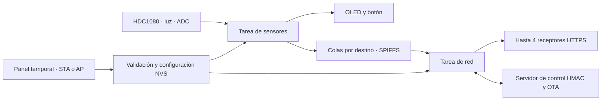

# TARS
### Monitoreo ambiental con ESP32 · FIWARE · mantenimiento sin cables

**Un firmware genérico para medir, visualizar y enviar datos ambientales a varios servidores.**

[Instalar](#instalación) · [Configurar](#primera-configuración-sin-puerto-serie) · [Conexiones](#sensores-y-conexiones) · [Arquitectura](#arquitectura) · [Guía completa](docs/guides/OPERACION.md)

## Qué hace

TARS mide temperatura, humedad relativa, iluminancia y señal de sonido. Muestra valores en una OLED SSD1306 y envía ventanas de muestras válidas como atributos NGSIv2. Está orientado a prototipos de monitoreo ambiental y comparación de condiciones en espacios interiores.

La versión 4.0.4 usa tareas independientes de lectura y red, hasta cuatro destinos HTTPS, colas persistentes y mantenimiento temporal por botón. Una petición HTTPS no ejecuta la lectura de sensores. El firmware conserva la medición durante mantenimiento.

**Estado:** compilación para ESP32 3.3.12 y pruebas de lógica verificadas; esta versión necesita validación física en un TARS antes de un despliegue en lote. La comunicación I²C y la lectura del HDC1080 deben comprobarse en cada equipo. El firmware no convierte este prototipo en un instrumento meteorológico o acústico certificado.

## Recuperación sin pantalla, servidor ni puerto serie

| Acción | Resultado |
|---|---|
| Clic corto con pantalla apagada | Despierta la misma página |
| Clic corto con pantalla encendida | Cambia de página |
| Mantener 4 segundos | Mantenimiento 10 minutos: IP actual si conectado; AP si desconectado |
| Seguir manteniendo hasta 10 segundos | AP de recuperación forzado durante 10 minutos, incluso con WiFi conectado |
| Reiniciar | Panel y AP cerrados; continúa la configuración guardada |

La pulsación de 10 segundos primero pasa por la acción de 4 segundos. La cuenta de recuperación comienza al llegar a los 10 segundos. Mantener el botón no renueva continuamente el plazo. Al soltarlo no se genera un clic adicional.

**AP:** `TARS-{identificador}` o `TARS-NEW-{sufijo MAC}`. **Dirección:** `http://192.168.4.1`. **Clave inicial del AP:** `tars12345678`. **Panel:** usuario `admin`, misma contraseña del AP. Se puede cambiar desde el panel; una clave vacía conserva la existente. La primera migración a 4.0.2 o posterior sustituye una vez la antigua clave aleatoria por esta clave inicial común.

El AP forzado usa AP+STA: conserva la conexión principal y no cambia sus credenciales. Cuando termina el plazo, cierra AP y panel. El modo normal retira el AP si vuelve la conexión principal; el modo forzado lo mantiene hasta que expire o se cierre. Una carga OTA en curso pospone los cambios de interfaz; el plazo de mantenimiento sigue vigente.

## Instalación

1. Instala Arduino IDE y **esp32 by Espressif Systems 3.3.12**.
2. Instala **ArduinoJson 7**, **Adafruit SSD1306**, **Adafruit GFX Library** y **Adafruit BusIO**. Versiones utilizadas: 7.4.3, 2.5.15, 1.12.4 y 1.17.4 respectivamente.
3. Abre [`firmware/TARS/TARS.ino`](firmware/TARS/TARS.ino). Mantén todos los archivos de esa carpeta, incluido `build_opt.h`.
4. Selecciona **ESP32-WROOM-DA Module**, flash **4 MB**, esquema **Default 4 MB con dos particiones OTA** y velocidad de carga **115200**. En un equipo instalado conserva su esquema existente. No elijas un esquema sin OTA ni borres toda la flash.
5. Selecciona el puerto y sube por USB para la instalación inicial. Monitor serie: **115200**.
6. Configura el equipo desde el panel. No hace falta recompilar por cada TARS ni editar credenciales en el código.

Este firmware es para ESP32 clásico; no cargarlo en ESP32-S3. Conservar el esquema de particiones es esencial para actualización OTA y datos persistentes.

## Primera configuración sin puerto serie

1. Enciende el equipo y mantén el botón **10 segundos**.
2. Conecta el teléfono al AP con `tars12345678` y abre manualmente `http://192.168.4.1`; no depende de un portal cautivo.
3. Accede con `admin` y esa clave.
4. Asigna un ID único, por ejemplo `tars_1`. Usa minúsculas, números, `_` y `-`; el ID definitivo queda vinculado y no se renombra desde el panel.
5. Elige WiFi y contraseña. Para `UPBWiFi`, escribe exactamente ese SSID, deja la clave vacía y marca **Usar una red abierta**.
6. Activa un destino HTTPS, configura URL, método y autenticación según el receptor. Para Orion NGSIv2, un ejemplo es `https://servidor.example.org/v2/entities/tars_1/attrs`, método `POST`, autenticación `none` si el servidor realmente la permite. La entidad y el enrutamiento deben existir en el servidor.
7. Ajusta lectura, envío y reintento. Valores iniciales: **5000 / 60000 / 20000 ms**.
8. Guarda toda la configuración con el botón global. Comprueba WiFi conectado, UTC listo y respuestas HTTP del destino. Un cambio de red tiene prueba de 180 segundos: si no se validan los canales configurados, revierte la configuración anterior.

[Contrato de control V2](docs/guides/CONTRATO_CONTROL_V2.md) · [Contrato OTA AMERI1](docs/guides/CONTRATO_OTA_AMERI1.md) · [Prompt para integrar el servidor](docs/guides/PROMPT_SERVIDOR_TARS.md).

Control y OTA desde servidor requieren URL base y clave HMAC **individual** de 64 caracteres hexadecimales en minúscula, suministrada por el servidor. Es distinta del token de telemetría y de la contraseña del AP. No inventar claves ni incluir credenciales reales en GitHub. La WiFi por sí sola no habilita control remoto.

## Sensores y conexiones

| Componente | Conexión en el firmware | Medida / función |
|---|---|---|
| ESP32-WROOM-DA | ESP32 clásico, flash 4 MB | WiFi, procesamiento y almacenamiento |
| OLED SSD1306 128×64 | SDA GPIO21 · SCL GPIO22 · `0x3C` (también se prueba `0x3D`) | Visualización |
| HDC1080 | Mismo I²C · `0x40` | Temperatura °C y humedad % |
| DFRobot B-LUX-V30B | Mismo I²C · `0x4A` · EN GPIO5 | Iluminancia en lux |
| Sensor de sonido analógico | GPIO35, entrada ADC | Voltaje; estimación según calibración |
| Botón | GPIO27 a GND, `INPUT_PULLUP` | Navegación, mantenimiento y recuperación |

SDA y SCL comparten bus a 50 kHz. Cambios de frecuencia CPU y acceso I²C se realizan por la tarea de sensores, entre transferencias. Se comprueba cada bloque de imagen OLED y se reintenta ante NACK.

**Alimentación:** GND común. La descripción del OLED permite VCC 3,3–5 V, pero las señales del ESP32 deben mantenerse a 3,3 V; comprobar a qué tensión están las resistencias pull-up. No conectar un sensor o alimentación a un GPIO suponiendo que puede entregar potencia. El esquema es lógico, no reemplaza el esquema eléctrico de la PCB ni confirma polaridad de conectores JST. GPIO35 no admite 5 V. Verifica tensión y pinout de cada módulo antes de conectarlo.

La variante PM1/PM2.5/PM10 que aparece en algunas fotos es experimental y **no está implementada en este firmware**. El sensor acústico analógico no está identificado como sonómetro: la estimación por voltaje no equivale a dBA, ponderación frecuencial o Leq. `noise` permanece nulo si no se declara calibración verificada; esa declaración tampoco certifica el instrumento.

## Arquitectura

- **Lectura:** cada 5 s por defecto. Mediana de hasta 15 lecturas de luz y promedio de muestras válidas por ventana.
- **Envío:** cierre de ventana cada 60 s por defecto; registros distintos por arranque y secuencia, mismo cuerpo para destinos activos.
- **Persistencia:** hasta 32 registros por destino. Si la cola se llena, se rechazan nuevos registros y aumenta el contador de pérdida; no es almacenamiento ilimitado.
- **Confirmación:** un destino elimina su registro tras respuesta HTTP 2xx; no implementa el ACK del histórico de pluviómetros. El receptor debe deduplicar por dispositivo, `boot_id` y `sequence` para tolerar respuestas perdidas.
- **HTTPS:** certificado raíz y reloj UTC necesarios; no usa `setInsecure`. Cada destino admite `none`, `bearer` u `oauth_password` con configuración propia.
- **Control:** protocolo HMAC V2 con expiración, secuencia persistente y ACK. OTA de servidor usa AMERI1 y exige compatibilidad de bootloader/particiones; consultar la guía.

## Datos y calidad

| Atributo | Unidad / significado |
|---|---|
| `temperature` | °C, promedio válido con offset configurable |
| `humidity` | %, promedio válido con offset configurable |
| `illuminance` | lux, mediana y promedio válido |
| `noise_voltage` | V, señal analógica |
| `noise_estimate_db` | Estimación por voltaje; no es medición acústica normalizada |
| `noise` | Estimación habilitada por `noise_verified`; nulo por defecto |
| `interval_seconds`, `sample_count` | Duración efectiva y número de muestras |
| `quality_flags`, `invalid_measurements` | Calidad, conteos válidos y máscara de fallos |
| `boot_id`, `sequence`, `observedAt` | Identificación y fecha UTC cuando existe sincronización |

Telemetría `schema_version=1`, atributos NGSIv2. No mezclar con el contrato histórico V2 del pluviómetro. La ausencia de lectura se representa como `null`, no como cero. [Detalle de operación y servidor](docs/guides/OPERACION.md).

## Energía

CPU 80 MHz por defecto, ahorro WiFi, brillo OLED 32/255 y apagado a los 60 s de inactividad. Todos se configuran en el panel. Sin deep sleep: el equipo conserva capacidad de recibir control remoto. No se promete una autonomía de batería sin medir el consumo de la PCB, sensores y regulador.

## Fotografías y hardware

Fotografías reales ya incluidas en el proyecto; muestran revisiones anteriores y no son capturas de validación del firmware 4.0.4.

<table><tr><td></td><td></td></tr><tr><td></td><td></td></tr></table>

Carcasas imprimibles en [`hardware/`](hardware/). Diagramas SVG editables en [`docs/diagrams/`](docs/diagrams/).

## Comprobar antes de instalar un lote

- Esperar el apagado de OLED; un clic debe despertarla sin saltar de página.
- Con WiFi conectada, 4 s abre panel en STA; 10 s crea AP y mantiene la conexión principal.
- Mantener el botón más de 10 s no debe renovar el plazo; soltar no cambia de página.
- En recuperación, conectar o desconectar la WiFi principal no elimina el AP.
- Después de 10 min, panel y AP cerrados; lecturas y envío continúan.
- Validar HDC1080, estabilidad OLED, HTTPS, conservación tras reinicio y OTA real en un equipo.

Pruebas de lógica con Node.js: `node tests/recovery.cjs` y `node tests/display.cjs`. Usan funciones extraídas del fuente con hardware simulado; no sustituyen pruebas físicas. [Resultados de compilación](docs/validation.json).

## Contribuir

Describe la placa, core ESP32, versión del firmware, sensor, pasos para reproducir y registro serie sin credenciales. Las mejoras pueden enviarse como pull requests. Si el proyecto te resulta útil, una estrella ayuda a que otros lo encuentren.

## Créditos y licencia

Proyecto del **Semillero AgeVital, Universidad Pontificia Bolivariana**. Supervisión técnica: **Henry Andrade Caicedo**. Desarrollo original: **Fer Castro**. Esta rama incorpora la nueva base del firmware y documentación.

El README histórico menciona MIT, pero el repositorio recibido no contiene un archivo LICENSE. La licencia del proyecto debe confirmarse por sus responsables antes de declarar permisos generales de distribución; las dependencias mantienen sus propias licencias.
