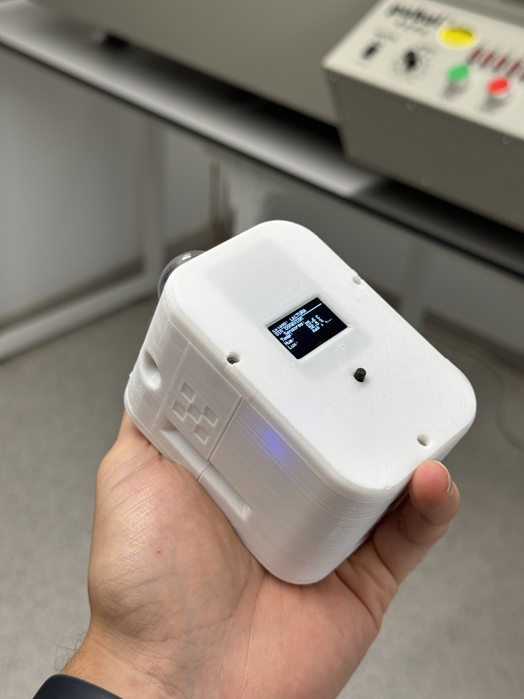
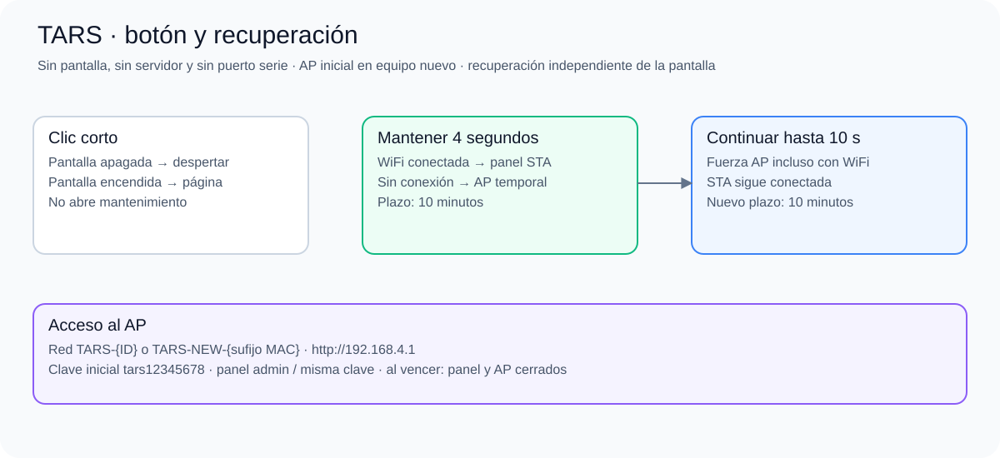
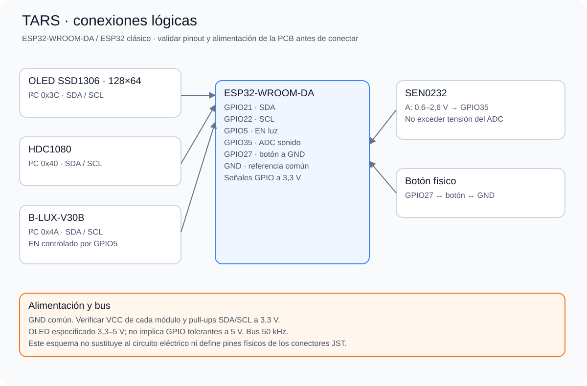
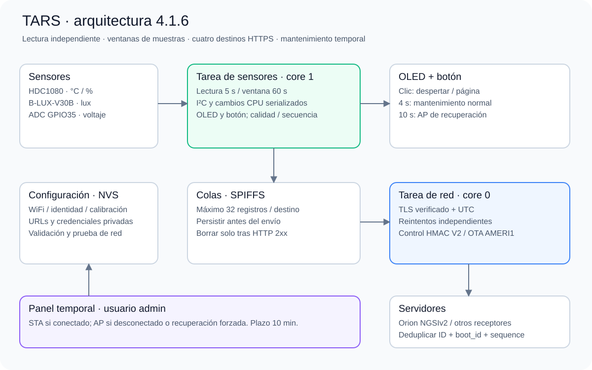
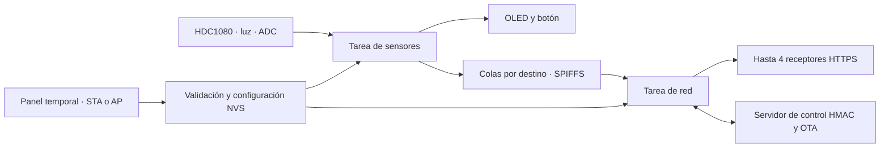
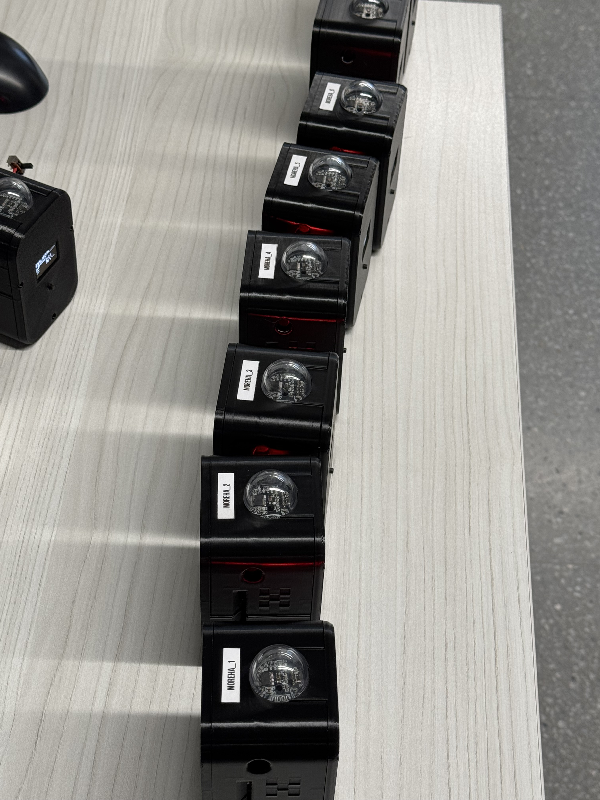
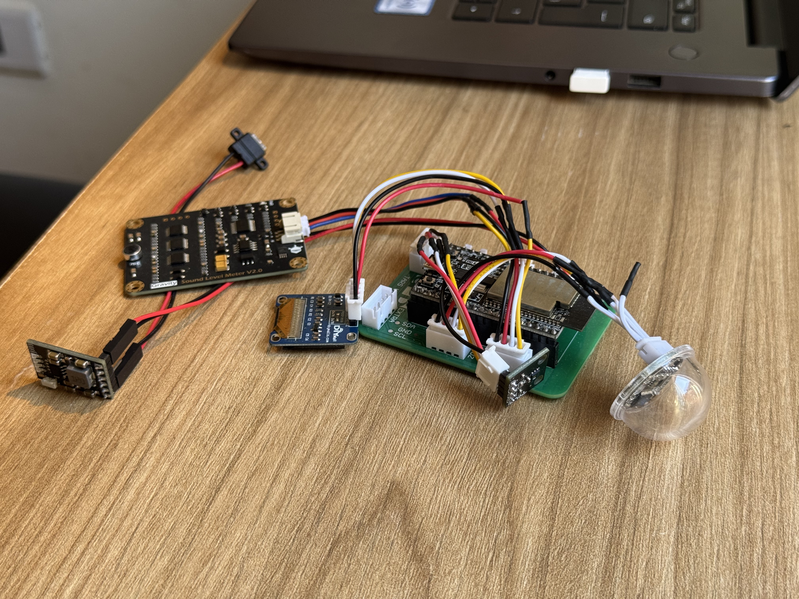
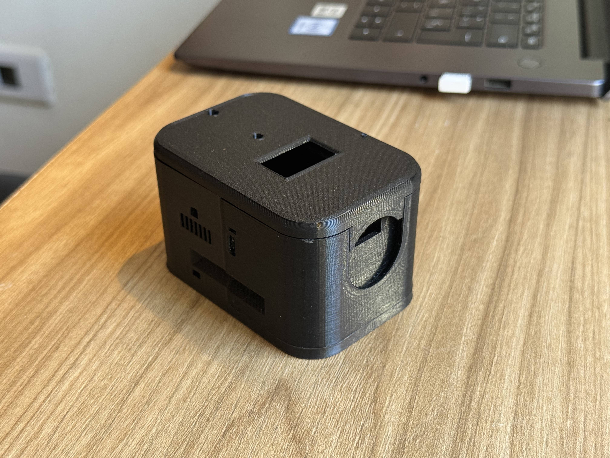
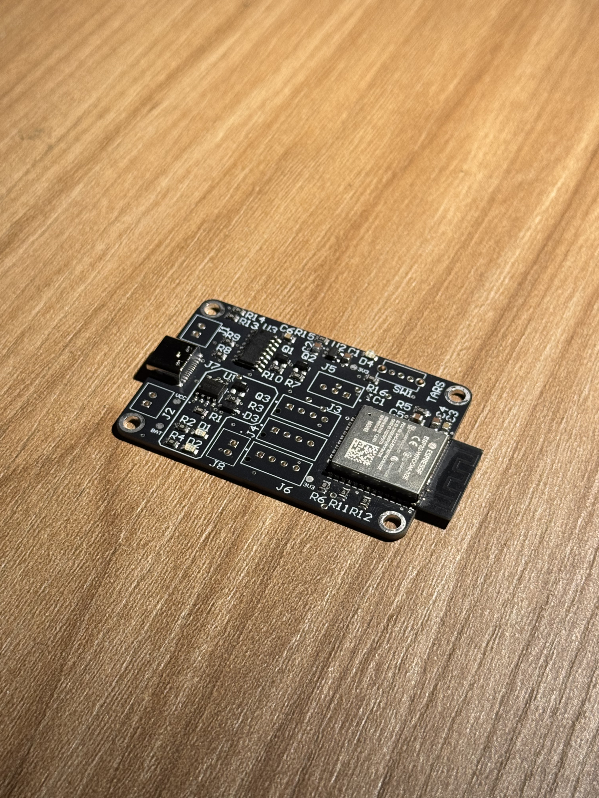

> Recuperación NVS 4.1.7: [procedimiento y límites](docs/guides/RECUPERACION_NVS_4.1.7.md). La validación física sigue pendiente.

# TARS
### Monitoreo ambiental con ESP32 · FIWARE · mantenimiento sin cables

**Un firmware genérico para medir, visualizar y enviar datos ambientales a varios servidores.**

[Instalar](#instalación) · [Configurar](#primera-configuración-sin-puerto-serie) · [Conexiones](#sensores-y-conexiones) · [Arquitectura](#arquitectura) · [Guía completa](docs/guides/OPERACION.md)

## Recuperación NVS 4.1.7

Detiene reintentos de persistencia fallidos, muestra el error y mantiene el AP durante la recuperación. La limpieza manual solo retira copias legadas cuando ha validado sus blobs sustitutos. Conserva identidad, claves, secuencias y configuración válida. Consulta el [procedimiento de recuperación](docs/guides/RECUPERACION_NVS_4.1.7.md) antes de instalar.

## Almacenamiento por bloques (introducido en 4.1.6)

El equipo devolvió `ESP_ERR_NVS_NOT_ENOUGH_SPACE` al guardar una cadena de 2365 bytes, con 352 entradas libres. Espressif documenta que una cadena necesita entradas contiguas en una misma página y puede fallar por fragmentación aunque haya espacio total. El firmware anterior usaba `nvs_set_str`; 4.1.6 usa `nvs_set_blob` para configuración y copia de prueba de red.

La configuración nueva reside en `cfg_blob` y su copia temporal en `backup_blob`, dentro de `tars4-config`. La cadena antigua `config` se conserva durante la migración; en 4.1.7 la recuperación manual puede retirarla únicamente después de validar `cfg_blob`. Si no existe el blob, se lee esa cadena. Un blob presente pero inválido no se sustituye silenciosamente por valores antiguos. Cada escritura hace commit y lectura exacta antes de aplicar la configuración en RAM. NVS aporta el almacenamiento multipágina y su comprobación de integridad. Las colas, credenciales, calibración y WiFi se conservan.

Si existe una copia de una prueba de red incompleta, se lee primero y se usa en RAM para recuperar la conexión; solo se retira después de guardar y verificar su restauración. 4.1.6 reintentaba la recuperación cada cinco segundos. En 4.1.7 un fallo pausa las siguientes escrituras y requiere recuperación manual. No se borra la partición NVS ni se limpian namespaces completos.

La migración no escribe el nuevo formato mientras la imagen OTA esté pendiente de validación. Una vez utilizado el blob, la OTA local y de servidor rechazan firmware anterior a **4.1.6** o con versión numérica incompatible, porque no sabe leerlo. Las actualizaciones futuras deben conservar el lector de este formato. Instalar firmware antiguo por USB elude esa protección y leería la copia antigua; reinstalar 4.1.6 o posterior recupera el blob, siempre que no se haya borrado la flash.

Mantener CPU a 240 MHz durante la prueba. Instalar sin borrar flash ni cambiar particiones; generar otro código para el mismo ID solo si la solicitud anterior caducó. Éxito esperado: `[CONFIG] verified key=cfg_blob bytes=...`, ID definitivo y contacto firmado reciente. Confirmar persistencia con un reinicio antes de desplegar otra unidad.

Pruebas de código y almacenamiento simulado realizadas; faltan validación NVS, OTA, cortes de alimentación y recepción de datos en el equipo físico. La API pública de configuración y los contratos de red no cambian.

## Guardado de vinculación 4.1.5

En el equipo probado, al configurar CPU a 240 MHz la vinculación recibió HTTP 200 y pasó la validación de su respuesta firmada; el fallo siguiente fue `storage_failed`. Esto localiza el nuevo problema en la escritura/verificación local de configuración. No demuestra todavía si NVS carece de espacio, está fragmentada, rechaza el tamaño o falla la lectura de verificación.

La versión 4.1.5 reduce el JSON privado eliminando únicamente indicadores derivados `*_set`. Conserva todos los ajustes y secretos reales; el JSON público no cambia. Mantiene namespace `tars4-config`, clave `config` y tipo cadena para permitir lectura por versiones anteriores. Las claves antiguas y las colas permanecen intactas. Cada escritura comprueba commit y lectura exacta antes de promover la configuración en RAM. Registra `[CONFIG]` con etapa, error ESP-IDF, tamaño y entradas libres; nunca imprime el JSON ni secretos.

Mantener 240 MHz durante esta comprobación; la actualización conserva el valor configurado. No se modifican certificados ni timeouts. La prueba temporal NETTEST de 4.1.4 se retira para liberar espacio OTA; el comando informa que se completó y remite a CONFIG. No se borra su marcador NVS. Las instrucciones siguientes de NETTEST son históricas y se aplican solo a 4.1.4.

Después de actualizar, si la petición caducó, generar otro código para el mismo ID y vincular. Éxito: `[CONFIG] verified`, ID definitivo y contacto firmado reciente confirmado por el servidor. Si falla, copiar la línea `[CONFIG]` y el estado de vinculación. No borrar flash ni crear otra identidad.

## Prueba única TCP/TLS 4.1.4

Con WiFi y UTC listos, abrir el monitor serie a 115200 y escribir `NETTEST` + Enter **antes del siguiente intento de vinculación**. No es necesario cambiar la petición si sigue vigente. Si caducó, generar otro código en Devices para el mismo ID. El comando arma una sola prueba; al comenzar, el firmware guarda `ran414` en un namespace NVS independiente (`tars-netdiag`). No toca configuración, credenciales, solicitud ni colas. No repite la prueba al reiniciar ni al reenviar NETTEST. Si la escritura del marcador falla, omite la prueba y conserva la vinculación normal.

La prueba abre TCP a la IP resuelta del hostname y al puerto original, mide el resultado y cierra el socket antes de comenzar TLS. TLS usa la misma CA en memoria que el envío real; conserva hostname para SNI y X.509. La conexión TLS probada es la del POST de vinculación: no hay una segunda CA ni otro cliente oculto. Si TLS tiene éxito, HTTPClient envía la solicitud sobre esa misma conexión. Si falla, se captura el resultado crudo inmediatamente antes de limpiar TLS.

`NETTEST-CLIENT same=1 ca=1` comprueba en ejecución que el puntero de cliente de HTTPClient es el cliente configurado y que conserva esa CA con verificación activa. Se registran timeouts efectivos del cliente y HTTPClient, UTC completa, CPU, heap/bloque contiguo antes/después de configurar y conectar, DNS/IP/puerto, y etapas `tcp`, `tls_setup`, `tls_handshake`, `http_result`. Los timeouts permanecen en 5000 ms TCP/HTTP y 8000 ms handshake; los valores previos a configurar pueden mostrar valores iniciales del core. errno es auxiliar y puede tener valores residuales incluso con una operación correcta.

Una conexión TCP de prueba cerrada sin HTTP es intencional. Pedir al servidor correlacionar conexiones, no solo POSTs. No cambiar certificados ni aumentar timeouts sin interpretar las etapas. En fuentes locales, TARS y pluviómetro comparten la misma CA y los mismos límites TLS/TCP; la configuración CA activa de un equipo puede proceder de NVS. TARS sí permite reducir CPU a 80 MHz; la fuente del pluviómetro revisada no la reduce explícitamente. El diagnóstico registra la CPU real, sin cambiarla.

Se comprimió también `/sha.js` para conservar espacio OTA; al descomprimir es idéntico al helper SHA-256 anterior. La interfaz y el cálculo de hash no cambian.

## Diagnóstico 4.1.3 y refresco OLED

Vinculación HTTPS: el monitor serie a 115200 informa `[PAIR-TLS]` con UTC ISO 8601, resultado DNS, IP usada, duración en ms, heap de 8 bits libre y mayor bloque contiguo, código mbedTLS y su descripción, y errno capturado. La captura de fallo ocurre antes de `NetworkClientSecure::stop()`; `[PAIR-HTTP]` informa después el resultado de HTTPClient y la duración total. Un fallo DNS se distingue de un fallo TLS. `tls_error=0` no confirma una conexión: puede no haberse iniciado TLS. errno es una instantánea auxiliar y no sustituye el error mbedTLS.

No se imprime URL, cuerpo de solicitud, código temporal, certificado, contraseña ni token. Se conservan CA, hostname/SNI, límites de tiempo y la solicitud persistida. No se cambian certificados por inferencia. El primer diagnóstico real debe obtenerse del equipo.

El estado serie se programa con un único vencimiento cada 10 segundos, sin ráfagas para recuperar vencimientos atrasados. La OLED conserva una copia de la imagen enviada y actualiza solo columnas modificadas de cada página. Las imágenes idénticas no producen tráfico I²C. Se mantiene 50 kHz y se invalidan las diferencias tras un NACK. El arranque y los cambios de página pueden requerir una imagen completa; no se promete eliminar todo efecto de barrido.

## Corrección 4.1.2: reinicio al vincular

Se recibió un registro real de `Task watchdog`, con `IDLE0` sin ejecutar y `tars-network` ocupando CPU 0 durante la vinculación HTTPS. Las tareas de red y OTA ahora comparten la prioridad de IDLE para que el planificador pueda ejecutar IDLE0 durante operaciones criptográficas largas. El watchdog sigue activo; se conservan los límites de tiempo HTTP/TLS y la configuración de energía. No se modifica el reloj de CPU durante I²C.

La actualización conserva WiFi, identidad, credenciales, calibración, petición de vinculación pendiente y colas. Después de instalarla, comprobar primero un equipo: versión 4.1.2, vinculación sin reinicios y contacto firmado en AMERI. La corrección está compilada y probada con un modelo de planificación; falta confirmar HTTPS y OTA en hardware.

## Qué hace

TARS mide temperatura, humedad relativa, iluminancia y señal de sonido. Muestra valores en una OLED SSD1306 y envía ventanas de muestras válidas como atributos NGSIv2. Está orientado a prototipos de monitoreo ambiental y comparación de condiciones en espacios interiores.

La versión 4.1.6 usa tareas independientes de lectura y red, hasta cuatro destinos HTTPS, colas persistentes y mantenimiento temporal por botón. Una petición HTTPS no ejecuta la lectura de sensores. El firmware conserva la medición durante mantenimiento.

**Estado:** compilación para ESP32 3.3.12 y pruebas de lógica verificadas; esta versión necesita validación física en un TARS antes de un despliegue en lote. La comunicación I²C y la lectura del HDC1080 deben comprobarse en cada equipo. El firmware no convierte este prototipo en un instrumento meteorológico o acústico certificado.

## Recuperación sin pantalla, servidor ni puerto serie

| Acción | Resultado |
|---|---|
| Clic corto con pantalla apagada | Despierta la misma página |
| Clic corto con pantalla encendida | Cambia de página |
| Mantener 4 segundos | Mantenimiento 10 minutos: IP actual si conectado; AP si desconectado |
| Seguir manteniendo hasta 10 segundos | AP de recuperación forzado durante 10 minutos, incluso con WiFi conectado |
| Reiniciar | Equipo configurado: panel/AP cerrados. Equipo nuevo sin ID ni WiFi: AP inicial 10 min |

La pulsación de 10 segundos primero pasa por la acción de 4 segundos. La cuenta de recuperación comienza al llegar a los 10 segundos. Mantener el botón no renueva continuamente el plazo. Al soltarlo no se genera un clic adicional.

**AP:** `TARS-{identificador}` o `TARS-NEW-{sufijo MAC}`. **Dirección:** `http://192.168.4.1`. **Clave inicial del AP:** `tars12345678`. **Panel:** usuario `admin`, misma contraseña del AP. Se puede cambiar desde el panel; una clave vacía conserva la existente. Las versiones 4.0.2–4.0.4 aplicaban una migración única de esa clave; 4.1.2 conserva las claves ya guardadas.

Tras vincular con AMERI, el servidor entrega una **clave individual** de mantenimiento. La clave común es solamente inicial. La actualización 4.1.2 conserva las claves existentes; no las vuelve a poner en el valor de fábrica.

El AP forzado usa AP+STA: conserva la conexión principal y no cambia sus credenciales. Cuando termina el plazo, cierra AP y panel. El modo normal retira el AP si vuelve la conexión principal; el modo forzado lo mantiene hasta que expire o se cierre. Una carga OTA en curso pospone los cambios de interfaz; el plazo de mantenimiento sigue vigente.

## Instalación

1. Instala Arduino IDE y **esp32 by Espressif Systems 3.3.12**.
2. Instala **ArduinoJson 7**, **Adafruit SSD1306**, **Adafruit GFX Library** y **Adafruit BusIO**. Versiones utilizadas: 7.4.3, 2.5.15, 1.12.4 y 1.17.4 respectivamente.
3. Abre [`firmware/TARS/TARS.ino`](firmware/TARS/TARS.ino). Mantén todos los archivos de esa carpeta, incluido `build_opt.h`.
4. Selecciona **ESP32-WROOM-DA Module**, flash **4 MB**, esquema **Default 4 MB con dos particiones OTA** y velocidad de carga **115200**. En un equipo instalado conserva su esquema existente. No elijas un esquema sin OTA ni borres toda la flash. El panel gzip viene generado: si editas `TarsPage.h`, ejecuta `python tools/pack_panel.py` antes de compilar. No hacen falta librerías extra.
5. Selecciona el puerto y sube por USB para la instalación inicial. Monitor serie: **115200**.
6. Configura el equipo desde el panel. No hace falta recompilar por cada TARS ni editar credenciales en el código.

Este firmware es para ESP32 clásico; no cargarlo en ESP32-S3. Conservar el esquema de particiones es esencial para actualización OTA y datos persistentes.

## Primera configuración sin puerto serie

1. Enciende el equipo y mantén el botón **10 segundos**.
2. Conecta el teléfono al AP con `tars12345678` y abre manualmente `http://192.168.4.1`; no depende de un portal cautivo.
3. Accede con `admin` y esa clave.
4. Asigna un ID único, por ejemplo `tars_1`. Usa minúsculas, números, `_` y `-`; el ID definitivo queda vinculado y no se renombra desde el panel.
5. Elige WiFi y contraseña. Para `UPBWiFi`, escribe exactamente ese SSID, deja la clave vacía y marca **Usar una red abierta**.
6. Activa un destino HTTPS, configura URL, método y autenticación según el receptor. Para Orion NGSIv2, un ejemplo es `https://servidor.example.org/v2/entities/tars_1/attrs`, método `POST`, autenticación `none` si el servidor realmente la permite. La entidad y el enrutamiento deben existir en el servidor.
7. Ajusta lectura, envío y reintento. Valores iniciales: **5000 / 60000 / 20000 ms**.
8. Guarda toda la configuración con el botón global. Comprueba WiFi conectado, UTC listo y respuestas HTTP del destino. Un cambio de red tiene prueba de 180 segundos: si no se validan los canales configurados, revierte la configuración anterior.

[Contrato de control V2](docs/guides/CONTRATO_CONTROL_V2.md) · [Contrato OTA AMERI1](docs/guides/CONTRATO_OTA_AMERI1.md) · [Prompt para integrar el servidor](docs/guides/PROMPT_SERVIDOR_TARS.md).

### Vincular con AMERI sin archivos ni claves HMAC manuales

Primero guarda WiFi y espera **UTC listo**. En AMERI Devices crea el mismo ID definitivo y genera un código temporal autorizado de 32 hex minúsculas. En el panel local, sección **Vincular con AMERI**, introduce ID, base de control (actualmente `https://infver.tail8e92a9.ts.net:10000`, sin barra final) y código. La URL Orion es otro campo y se conserva.

El equipo guarda la petición y su nonce antes de enviarla, valida HTTPS, ID/MAC/perfil/firma y confirma credenciales mediante un único guardado de configuración. Después inicia control V2 y OTA AMERI1. Un HTTP 200 de pairing no confirma contacto firmado: espera el reporte HMAC y comprueba Último contacto en Devices.

**Añadir histórico AMERI** es opcional. Solo usa un slot completamente libre sin pendientes; conserva todos los otros destinos. Si no hay espacio, informa que la vinculación quedó guardada y que el histórico necesita elegir destino desde Devices. Si el receptor histórico proyecta a Orion, desactiva explícitamente el envío directo a esa misma entidad para evitar duplicados.

Antes de cerrar el panel, usa **Consultar nueva clave de mantenimiento** y guárdala privadamente. La sesión actual conserva su clave de acceso hasta cerrarse; las siguientes usan la clave individual. La consulta devuelve únicamente la clave del AP, nunca control_key, Bearer ni el payload bruto. Diagnósticos/reportes no contienen contraseñas.

[Contrato y pruebas de vinculación](docs/guides/VINCULACION.md). El servidor de vinculación debe estar instalado y validado en la Raspberry; este repositorio no prueba su despliegue físico.

También se conserva la provisión manual: control y OTA desde servidor requieren URL base y clave HMAC **individual** de 64 caracteres hexadecimales en minúscula, suministrada por el servidor. Es distinta del token de telemetría y de la contraseña del AP. No inventar claves ni incluir credenciales reales en GitHub. La WiFi por sí sola no habilita control remoto.

## Sensores y conexiones

| Componente | Conexión en el firmware | Medida / función |
|---|---|---|
| ESP32-WROOM-DA | ESP32 clásico, flash 4 MB | WiFi, procesamiento y almacenamiento |
| OLED SSD1306 128×64 | SDA GPIO21 · SCL GPIO22 · `0x3C` (también se prueba `0x3D`) | Visualización |
| HDC1080 | Mismo I²C · `0x40` | Temperatura °C y humedad % |
| DFRobot B-LUX-V30B | Mismo I²C · `0x4A` · EN GPIO5 | Iluminancia en lux |
| DFRobot SEN0232 | GPIO35, entrada ADC | Nivel sonoro dBA; salida 0,6–2,6 V |
| Botón | GPIO27 a GND, `INPUT_PULLUP` | Navegación, mantenimiento y recuperación |

SDA y SCL comparten bus a 50 kHz. Cambios de frecuencia CPU y acceso I²C se realizan por la tarea de sensores, entre transferencias. Se comprueba cada bloque de imagen OLED y se reintenta ante NACK.

**Alimentación:** GND común. La descripción del OLED permite VCC 3,3–5 V, pero las señales del ESP32 deben mantenerse a 3,3 V; comprobar a qué tensión están las resistencias pull-up. No conectar un sensor o alimentación a un GPIO suponiendo que puede entregar potencia. El esquema es lógico, no reemplaza el esquema eléctrico de la PCB ni confirma polaridad de conectores JST. GPIO35 no admite 5 V. Verifica tensión y pinout de cada módulo antes de conectarlo.

La variante PM1/PM2.5/PM10 que aparece en algunas fotos es experimental y **no está implementada en este firmware**. El sensor acústico confirmado es **DFRobot SEN0232**, ponderación A y constante temporal 125 ms. Conversión del fabricante: **dBA = V × 50** (0,6–2,6 V → 30–130 dBA). `noise` contiene el promedio aritmético de muestras válidas del intervalo, **no Leq**; no captura todos los picos entre lecturas. La marca de configuración `noise_verified` indica contraste de campo; la conversión 50/0 usa la base de fábrica. La calidad distingue fábrica y campo; ajustes personalizados no contrastados mantienen `noise=null`. [Integración y fuentes oficiales](docs/guides/SEN0232.md).

## Arquitectura

- **Lectura:** cada 5 s por defecto. Mediana de hasta 15 lecturas de luz y promedio de muestras válidas por ventana.
- **Envío:** cierre de ventana cada 60 s por defecto; registros distintos por arranque y secuencia, mismo cuerpo para destinos activos.
- **Persistencia:** hasta 32 registros por destino. Si la cola se llena, se rechazan nuevos registros y aumenta el contador de pérdida; no es almacenamiento ilimitado.
- **Confirmación:** un destino elimina su registro tras respuesta HTTP 2xx; no implementa el ACK del histórico de pluviómetros. El receptor debe deduplicar por dispositivo, `boot_id` y `sequence` para tolerar respuestas perdidas.
- **HTTPS:** certificado raíz y reloj UTC necesarios; no usa `setInsecure`. Cada destino admite `none`, `bearer` u `oauth_password` con configuración propia.
- **Control:** protocolo HMAC V2 con expiración, secuencia persistente y ACK. OTA de servidor usa AMERI1 y exige compatibilidad de bootloader/particiones; consultar la guía.

## Datos y calidad

| Atributo | Unidad / significado |
|---|---|
| `temperature` | °C, promedio válido con offset configurable |
| `humidity` | %, promedio válido con offset configurable |
| `illuminance` | lux, mediana y promedio válido |
| `noise_voltage` | V, señal analógica |
| `noise_estimate_db` | Alias conservado por compatibilidad; preferir `noise` y su metadato |
| `noise` | SEN0232, dBA: promedio de muestras válidas, ponderación A/Fast; no Leq |
| `interval_seconds`, `sample_count` | Duración efectiva y número de muestras |
| `quality_flags`, `invalid_measurements` | Calidad, conteos válidos y máscara de fallos |
| `boot_id`, `sequence`, `observedAt` | Identificación y fecha UTC cuando existe sincronización |

Telemetría `schema_version=1`, atributos NGSIv2. No mezclar con el contrato histórico V2 del pluviómetro. La ausencia de lectura se representa como `null`, no como cero. [Detalle de operación y servidor](docs/guides/OPERACION.md).

## Energía

CPU 80 MHz por defecto, ahorro WiFi, brillo OLED 32/255 y apagado a los 60 s de inactividad. Todos se configuran en el panel. Sin deep sleep: el equipo conserva capacidad de recibir control remoto. No se promete una autonomía de batería sin medir el consumo de la PCB, sensores y regulador.

## Fotografías y hardware

Fotografías reales ya incluidas en el proyecto; muestran revisiones anteriores y no son capturas de validación del firmware 4.1.2.

<table><tr><td></td><td></td></tr><tr><td></td><td></td></tr></table>

Carcasas imprimibles en [`hardware/`](hardware/). Diagramas SVG editables en [`docs/diagrams/`](docs/diagrams/).

## Comprobar antes de instalar un lote

- Esperar el apagado de OLED; un clic debe despertarla sin saltar de página.
- Con WiFi conectada, 4 s abre panel en STA; 10 s crea AP y mantiene la conexión principal.
- Mantener el botón más de 10 s no debe renovar el plazo; soltar no cambia de página.
- En recuperación, conectar o desconectar la WiFi principal no elimina el AP.
- Después de 10 min, panel y AP cerrados; lecturas y envío continúan.
- Validar HDC1080, estabilidad OLED, HTTPS, conservación tras reinicio y OTA real en un equipo.

Pruebas de lógica con Node.js: `node tests/recovery.cjs`, `node tests/display.cjs` y `node tests/pairing.cjs` y `node tests/sound.cjs`. Usan funciones extraídas del fuente con hardware simulado; no sustituyen pruebas físicas. [Resultados de compilación](docs/validation.json).

## Ramas y versiones

- `develop`: integración de cambios y pruebas; el nombre no depende de la versión.
- `main`: versiones que los responsables hayan validado y fusionado.
- La versión de firmware se define en `firmware/TARS/AmeriProfile.h` y en el changelog.

Antes de fusionar una nueva versión, probarla en un TARS. Los commits futuros de esta copia usan la identidad Git de `1cfer` con su correo privado de GitHub. La autoría de commits y la autenticación para publicar son configuraciones distintas.

## Contribuir

Describe la placa, core ESP32, versión del firmware, sensor, pasos para reproducir y registro serie sin credenciales. Las mejoras pueden enviarse como pull requests. Si el proyecto te resulta útil, una estrella ayuda a que otros lo encuentren.

## Créditos y licencia

Proyecto del **Semillero AgeVital, Universidad Pontificia Bolivariana**. Supervisión técnica: **Henry Andrade Caicedo**. Desarrollo original: **Fer Castro**. Esta rama incorpora la nueva base del firmware y documentación.

El README histórico menciona MIT, pero el repositorio recibido no contiene un archivo LICENSE. La licencia del proyecto debe confirmarse por sus responsables antes de declarar permisos generales de distribución; las dependencias mantienen sus propias licencias.
